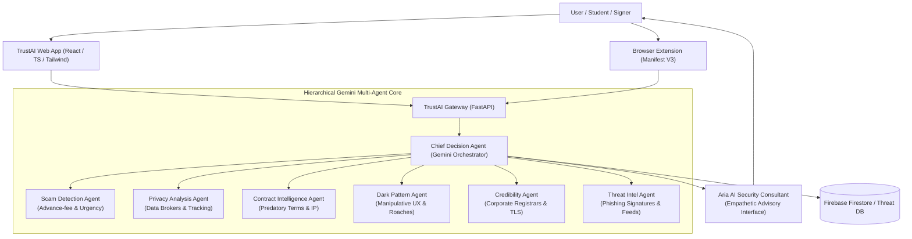
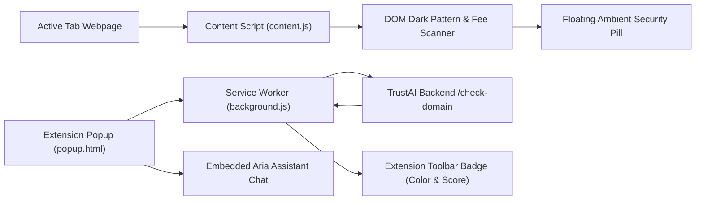

# TrustAI — Multi-Agent AI Security & Scam Defense Intelligence System

> **Empowering people over predatory technology.**  
> Built with Google Gemini, FastAPI, React, TypeScript, and Chrome Manifest V3.

---

## 🌟 Vision

To create a safer and more transparent internet where digital technology empowers human autonomy, financial dignity, and privacy rather than exploiting cognitive biases, desperation, or legal opacity.

## 🎯 Mission

To protect everyday users—especially students, freelancers, job seekers, and consumers—from fraudulent internships, predatory contractual fine print, deceptive dark UX patterns, privacy abuse, and phishing schemes by deploying an authoritative, empathetic AI Security Consultant (**Aria**) backed by a hierarchical multi-agent fleet.

---

## 🛑 Problem Statement

The modern internet suffers from severe **information and power asymmetry**:

1. **Predatory Internship & Job Scams**: Scammers actively target students and career switchers on LinkedIn, Telegram, and job boards. Candidates are sent fraudulent offer letters demanding upfront "equipment security deposits", "training fees", or "laptop insurance" via untraceable payment channels.
2. **Contractual Fine Print & Hidden Liabilities**: Independent contractors and consumers routinely sign agreements containing broad intellectual property forfeiture, 2-year non-compete covenants, unilateral indemnification, and mandatory binding arbitration waivers that strip them of constitutional court recourse.
3. **Deceptive UX & Dark Patterns**: E-commerce platforms and SaaS services weaponize behavioral economics through false urgency countdown timers, confirmshaming, hidden cancellation mazes (roach motels), and drip pricing.
4. **Digital Privacy Abuse**: 50-page privacy policies conceal the ongoing sale of personal GPS telemetries, contact books, and device fingerprints to third-party data brokers and marketing aggregators.

---

## 🌐 Social Implications of Technology

Technology should serve as an equalizer, but unvetted platforms and automated deception disproportionately harm vulnerable demographics:
- **Financial Harm to Students**: College students losing $200–$1,000 to fake internship equipment deposits face immediate financial distress and psychological trauma.
- **Erosion of Worker Rights**: Freelancers lose ownership of their own pre-existing codebases and portfolios due to predatory "all-inventions" contractual assignments.
- **Compounding Surveillance**: Marginalized users who rely on predatory mobile apps unwittingly surrender their contacts and location data to commercial syndicates.

**TrustAI reverses this dynamic** by giving every individual their own 24/7 personal digital rights advocate and cybersecurity team.

---

## 💡 Solution Overview

TrustAI introduces a **Hierarchical Multi-Agent AI Security Platform**:
- **Aria (AI Security Consultant)**: A human-toned, protective security advisor. Instead of generic report dumps, Aria answers questions authoritatively (e.g., *"Should I accept this offer?"* → *"I reviewed the offer. Key concerns: Security deposit required, no company registration found. My recommendation: Avoid paying any upfront amount. Confidence: 87%"*).
- **Hierarchical Agent Fleet**: Six specialized Gemini agents evaluate specific threat vectors concurrently.
- **Chief Decision Agent**: De-duplicates agent findings, weights risk factors, calculates an overall Trust Score (0–100), and issues the definitive Verdict (`SAFE`, `CAUTION`, `HIGH RISK`, `SCAM LIKELY`).
- **Browser Extension (Manifest V3)**: Real-time web navigation monitor, DOM dark pattern scanner, floating security badge, and instant "Ask Aria" popup bridge.

---

## 🏗️ System Architecture



---

## 🤖 Multi-Agent Architecture

| Agent Name | Core Responsibilities | Specialized Gemini System Prompt Focus |
| :--- | :--- | :--- |
| **Scam Detection Agent** | Detects advance-fee fraud, upfront laptop deposits, telegram recruiting, inflated wage lures, and crypto demands. | Structured scam risk score, indicators, urgency tactics, and concrete recommendations. |
| **Privacy Analysis Agent** | Audits privacy policies for data broker monetization, cross-app tracking, and unnecessary device permissions. | Privacy score (0-100), high-risk disclosures, broker sharing analysis, user-friendly plain English breakdown. |
| **Contract Agent** | Evaluates freelance contracts, NDAs, and terms of service for IP forfeiture, arbitration waivers, and cancellation traps. | Flagged predatory clauses with side-by-side plain-English translations and liability caps. |
| **Dark Pattern Agent** | Scans website DOM and UX copy for false urgency, fake scarcity timers, confirmshaming, and drip fees. | Manipulative design severity score and highlighted deceptive UI elements. |
| **Credibility Agent** | Analyzes corporate registrar indexing, domain registration age, SSL authenticity, and email spoofing. | Verifies corporate legitimacy, detecting public @gmail recruiters representing supposed enterprises. |
| **Threat Intel Agent** | Matches targets against phishing signatures, punycode attacks, homoglyph domain impersonation, and disposable TLDs. | Threat classification (`CLEAN`, `SUSPICIOUS`, `MALICIOUS`, `PHISHING`). |
| **Chief Decision Agent** | Asynchronously orchestrates all 6 agents, synthesizes findings, removes duplicates, and computes Trust Score (0-100). | Final Verdict formulation (`SAFE`, `CAUTION`, `HIGH RISK`, `SCAM LIKELY`) with executive summary and immediate actions. |
| **Aria AI Consultant** | Provides conversational, empathetic, and authoritative advice to users seeking guidance. | Human-first consultation formatting (Direct answer, Key concerns, Actionable recommendation, Confidence score). |

---

## 🧩 Browser Extension Architecture (Manifest V3)



- **Manifest V3 Compliant**: Built with service workers and declarative lifecycle permissions.
- **Content Script DOM Scanner**: Automatically evaluates page inner text and input elements for countdown timers, pre-selected checkboxes, and deposit demands.
- **Floating Security Pill**: Injects a clean, non-intrusive floating indicator with one-click threat warnings.
- **Dynamic Badge**: Changes color from Emerald (`SAFE`) to Amber (`CAUTION`) to Red (`SCAM LIKELY`).

---

## 🗄️ Database Design (Firebase Firestore)

TrustAI stores scan records, audit history, and consultation logs in Firebase Firestore with automatic in-memory fallback:

### Collection: `trustai_scans`
```json
{
  "scan_id": "scan_int_001",
  "target_identifier": "NovaTech Digital Labs - Front-End Intern",
  "category": "internship",
  "trust_score": 14,
  "verdict": "SCAM LIKELY",
  "verdict_badge_color": "red",
  "confidence_percentage": 93,
  "executive_summary": "High-risk internship offer. Upfront security deposit demanded for equipment with communication routed over Telegram.",
  "key_concerns": [
    "Security deposit required for equipment delivery ($250)",
    "Recruitment routed via informal Telegram channel",
    "No state corporate registrar filing found"
  ],
  "immediate_actions": [
    "Do NOT pay any security deposit under any circumstance.",
    "Cease all contact with the recruiter."
  ],
  "created_at": "2026-10-27T08:14:00Z",
  "scam_risk": 95,
  "privacy_index": 20,
  "contract_fairness": 10,
  "dark_pattern_severity": 75,
  "credibility_index": 12,
  "scam_analysis": { ... },
  "contract_analysis": { ... },
  "privacy_analysis": { ... },
  "dark_pattern_analysis": { ... },
  "credibility_analysis": { ... },
  "threat_analysis": { ... }
}
```

### Collection: `trustai_chat_history`
```json
{
  "conversation_id": "conv_1729900000",
  "messages": [
    {
      "user_prompt": "Should I accept this internship offer?",
      "assistant_reply": "I reviewed the internship offer...",
      "structured_advice": {
        "direct_answer": "I reviewed the internship offer.",
        "key_concerns": ["Security deposit required", "No company registration found"],
        "actionable_recommendation": "Avoid paying any upfront amount until verification is complete.",
        "confidence_percentage": 87,
        "risk_level": "SCAM LIKELY"
      },
      "timestamp": "2026-10-27T08:15:00Z"
    }
  ]
}
```

---

## 📡 API Documentation

### Base URL: `http://localhost:8000` (or your Render URL)

#### 1. Universal Security Analysis
- **`POST /api/analyze`**
  - **Body**: `{"url": "https://example.com", "text_content": "...", "category": "website"}`
  - **Response**: `ChiefVerdict` object containing composite Trust Score and agent breakdowns.

#### 2. Internship Verification
- **`POST /api/internship/verify`**
  - **Body**:
    ```json
    {
      "company_name": "NovaTech Labs",
      "job_title": "Data Analyst Intern",
      "recruiter_email": "hr@gmail.com",
      "recruiter_channel": "Telegram",
      "stipend_claimed": "$45/hr",
      "deposit_required": true,
      "deposit_amount": "$250",
      "offer_letter_text": "..."
    }
    ```
  - **Response**: Full multi-agent consensus report and flags.

#### 3. Contract & Fine Print Intelligence
- **`POST /api/contract/analyze`**
  - **Body**: `{"contract_title": "...", "contract_type": "Freelance", "contract_text": "..."}`
  - **Response**: Predatory clause translations, arbitration lock-in flags, and fairness score.

#### 4. Aria AI Security Consultant
- **`POST /api/chat`**
  - **Body**: `{"message": "Should I accept this offer?", "attached_context": { ... }}`
  - **Response**:
    ```json
    {
      "conversation_id": "conv_123",
      "reply_text": "I reviewed the internship offer...",
      "structured_advice": {
        "direct_answer": "I reviewed the internship offer.",
        "key_concerns": ["Security deposit required", "No company registration found"],
        "actionable_recommendation": "Avoid paying any upfront amount until verification is complete.",
        "confidence_percentage": 87,
        "risk_level": "SCAM LIKELY"
      }
    }
    ```

#### 5. Browser Extension Gateway
- **`GET /api/extension/check-domain?url=https://example.com`**
- **`POST /api/extension/scan-dom`**

---

## 🚀 Local Setup Instructions

### Prerequisites
- Python 3.10+ (or `uv`)
- Node.js 18+ & npm
- Google Gemini API Key ([Get one free from Google AI Studio](https://aistudio.google.com/))

### 1. Clone & Set Up Backend
```bash
git clone https://github.com/your-username/trustai.git
cd trustai/backend

# Configure Environment
cp .env.example .env
# Edit .env and paste your GEMINI_API_KEY=AIzaSy...

# Install dependencies (using pip or uv)
pip install -r requirements.txt

# Run the FastAPI server
uvicorn app.main:app --reload --host 0.0.0.0 --port 8000
```
API Documentation will be live at: `http://localhost:8000/docs`

### 2. Set Up Frontend
```bash
cd ../frontend

# Install dependencies
npm install

# Run Vite development server
npm run dev
```
Web application will be accessible at: `http://localhost:5173`

### 3. Load Browser Extension
1. Open Google Chrome and go to `chrome://extensions/`.
2. Enable **Developer mode** (top right toggle).
3. Click **Load unpacked** and select the `trustai/extension` directory.

---

## 🐳 Docker & Docker Compose

Run the entire platform with a single command:
```bash
docker-compose up --build
```
- Frontend: `http://localhost:5173`
- Backend: `http://localhost:8000`

---

## ☁️ Deployment Instructions

### Deploy to Render

This repository includes a ready-to-deploy `render.yaml` Blueprint:

1. Push your repository to GitHub.
2. Log into [Render](https://render.com).
3. Click **New +** → **Blueprint**.
4. Connect your GitHub repository. Render will automatically detect `render.yaml` and provision:
   - **`trustai-backend`**: FastAPI Python Web Service.
   - **`trustai-frontend`**: Static Site with client-side rewrite rules.
5. In the Render Dashboard under `trustai-backend`, add your secret environment variable:
   - `GEMINI_API_KEY`: Your Google Gemini API key.

---

## 🔄 GitHub Workflows (CI/CD)

- **Continuous Integration (`.github/workflows/ci.yml`)**:
  - Automatically runs pytest suite on every push.
  - Type-checks and builds frontend with Vite and TypeScript.
- **Continuous Deployment (`.github/workflows/deploy.yml`)**:
  - Automatically triggers Render deploy webhooks on merge to `main`.

---

## 🗺️ Future Roadmap

- [x] Hierarchical Multi-Agent Gemini Architecture
- [x] Aria AI Security Consultant
- [x] Manifest V3 Browser Extension with DOM Dark Pattern Scanner
- [x] Student Internship Verification Portal
- [x] Contract & Fine Print Plain-English Translator
- [ ] University Career Center Single Sign-On (SSO) & Campus Fraud Alerts
- [ ] Mobile App (React Native) for SMS Phishing and WhatsApp Job Fraud Scanning
- [ ] Automated Letter-of-Demand Generator for Unfair Contract Dispute Resolution

---

## 👥 Team & Acknowledgments

- **Lead Architect & AI Engineer**: TrustAI Core Team
- **AI Brain**: Google Gemini-4 API via Google AI Studio
- **UX & Design Philosophy**: Inspired by the clean, humane design systems of Notion, Stripe, and Apple.

---

## 📄 License

Distributed under the **MIT License**. See `LICENSE` for more information.
